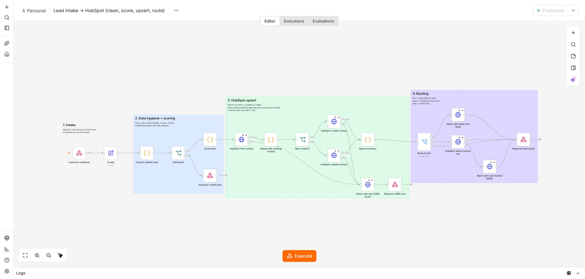
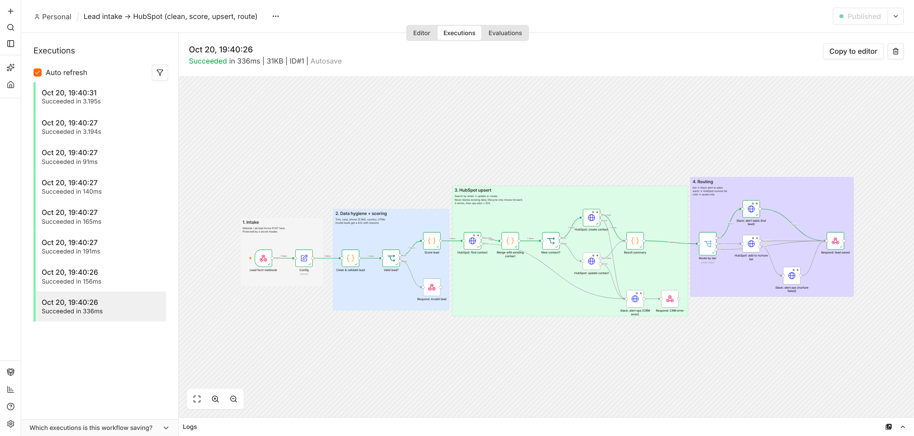

# Lead intake → HubSpot: an n8n marketing-ops workflow

A production-style n8n workflow for the most common marketing-ops job: getting leads from website and ad forms into the CRM **cleanly**, **without duplicates**, **scored**, and **routed** to the right next step. It also handles the failure cases properly.



## What it does

```text
Form / ad lead ──► 1. Intake ──► 2. Clean + validate ──► invalid? ──► 422 + reasons
   (webhook,         (secret       (names, email, phone E.164,
    secret header)    header)       country, website, UTMs)
                                          │
                                          ▼
                                    3. Score lead (rules, with reasons)
                                          │
                                          ▼
                     4. HubSpot: search by email ──► update existing ─┐
                                          └────────► create new ──────┤
                                                                       ▼
                                                    5. Route by tier
                                     hot ─► Slack alert to sales (score + reasons)
                                     warm ─► HubSpot nurture list
                                     cold ─► saved only
   Any HubSpot failure ─► 3 retries ─► Slack alert to ops ─► 502 to the form
```

### Data rules (where most CRM mess comes from)
- **No duplicates.** Contacts are matched by email, case-insensitively, before anything is created.
- **No data loss.** Blank form fields never overwrite existing CRM values. Name, company, title, website and country that sales has already set are kept.
- **Lifecycle only moves forward.** A form fill can't drag a sales-qualified lead back to "lead", which HubSpot rejects anyway.
- **Standardised fields.** Names are title-cased, emails lower-cased, phones converted to E.164 (`(415) 555-0134` becomes `+14155550134`), country variants unified (`usa`/`US` become `United States`), and the website is derived from a business email domain.
- **Attribution.** The latest UTM source, medium and campaign are stored on every submission.
- **Explainable scoring.** Every point has a reason (`+30 senior title (VP Marketing)`), shown in the sales alert and the response.

### Failure handling
| Situation | What happens |
|---|---|
| Invalid email or missing data | `422` with the reasons; nothing touches the CRM |
| Missing or wrong webhook secret | Request refused by n8n; nothing saved |
| HubSpot error or outage | 3 retries, then a Slack alert to ops with the lead's email, then `502` to the form. The execution is kept in n8n for a one-click retry |
| Nurture-list call fails | The lead is still saved (`200`); ops are alerted |
| Slack is down | Doesn't block the lead |

## Tested

`test/run_tests.py` runs the **actual workflow in a real n8n instance** (n8n 2.44) against mock HubSpot and Slack APIs that record every call. It covers 9 scenarios and 30 checks: new hot lead with messy data, duplicate submission, existing contact, warm, cold, invalid email, bad secret, HubSpot outage and nurture-list outage. **All pass.** Full results, including what the form sent and what reached HubSpot: [docs/test-report.md](docs/test-report.md).



```bash
npm install n8n          # n8n 2.x needs Node.js 24+
python3 test/run_tests.py --n8n ./node_modules/.bin/n8n
```

## Set it up with a real HubSpot account

1. **HubSpot private app.** Go to Settings → Integrations → Private Apps → Create. Give it the scopes `crm.objects.contacts.read`, `crm.objects.contacts.write`, `crm.lists.read` and `crm.lists.write`, then copy the token.
2. **Custom contact properties.** Under Settings → Properties → Contact, create: `lead_score` (number), `lead_tier` (single-line text), `latest_utm_source`, `latest_utm_medium`, `latest_utm_campaign` (single-line text), and `marketing_consent` (single checkbox).
3. **Nurture list.** Create a static contact list in HubSpot and note its list ID.
4. **Slack.** Create an incoming webhook for your sales channel.
5. **Import into n8n.** Go to Workflows → Import from file → `workflow/lead-to-hubspot.json`, then:
   - Create a **Header Auth** credential named *HubSpot private app token*: name `Authorization`, value `Bearer <token>`. Select it on the four HubSpot nodes.
   - Create a **Header Auth** credential named *Lead form webhook secret*: name `X-Webhook-Secret`, value a long random string. Select it on the webhook node.
   - Open **Config** and set `slackWebhookUrl`, `nurtureListId`, and the `hotScore`/`warmScore` thresholds if needed.
6. **Publish** the workflow and point your form at `https://<your-n8n>/webhook/lead-intake`, sending the `X-Webhook-Secret` header. Most form tools (Webflow, Typeform, Tally, Unbounce, Meta lead ads via Zapier/Make) can POST JSON with a header.

### Field mapping
The intake accepts common field names, so most forms work without changes:

| Lead field | Accepted names |
|---|---|
| email | `email` |
| first / last name | `first_name`, `firstname`, `firstName` / `last_name`… or one `name` / `full_name` |
| job title | `job_title`, `jobtitle`, `title` |
| company size | `employees`, `company_size` |
| UTMs | `utm_source`, `utm_medium`, `utm_campaign`, or `utm: {source, medium, campaign}` |
| form type | `form`, `form_type` (`demo_request` and `contact_sales` score higher) |
| others | `phone`, `company`, `website`, `country`, `budget`, `message`, `marketing_consent` |

## Files

| Path | |
|---|---|
| `workflow/lead-to-hubspot.json` | **The workflow to import into n8n** |
| `workflow/build_workflow.py` | Generates the JSON from the sources below (node wiring lives here) |
| `code/*.js` | The Code-node logic: clean and validate, score, merge with existing contact, summary |
| `test/run_tests.py`, `test/mock_services.py` | End-to-end test harness |
| `docs/` | Screenshots and test report |

To change the logic, edit `code/*.js`, then run `python3 workflow/build_workflow.py` and re-import.

## Adapting it
- **A different CRM** (Salesforce, Pipedrive, Zoho): swap the three HubSpot HTTP nodes. The cleaning, scoring and routing stay the same.
- **Different scoring:** edit `code/score-lead.js`. The rules are plain and commented.
- **More destinations:** add branches after **Route by tier**, for example Google Sheets logging, an email platform, or a task for the account owner.
