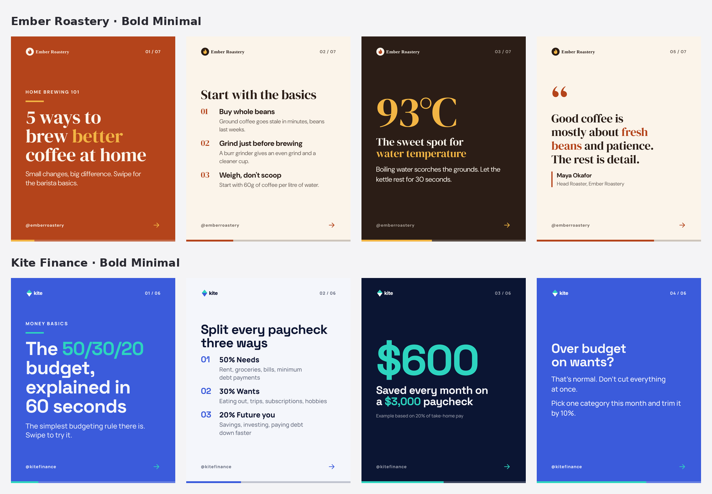

# Carousel Design System: a Claude skill

One skill for the whole agency. It turns a copy brief into on-brand 4:5 carousel slides (1080×1350 PNGs plus a PDF) for any client. Each export is QA-checked first and saved as a numbered version, so revisions take seconds.

```text
brief (copy)  +  style (layout)  +  brand kit (colours, fonts, logo)
                         │
                 render in headless Chromium
                         │
          auto-fit copy → automated QA (14 checks)
                         │
        pass → v01/ PNGs + PDF + contact sheet + report
        fail → _qa-failed/ annotated previews + exact fixes
```

| | |
|---|---|
| **Styles** | `bold-minimal`, `editorial`, `card-stack` (add more from your references: see `reference/style-authoring.md`) |
| **Layouts** | cover, text, list, quote, stat, image, cta, all available in every style |
| **Clients** | One folder per client in `brands/`. Two fictional examples are included |
| **Output** | `slug-01.png … slug-NN.png` (posting order), `slug.pdf` (LinkedIn document post), `contact-sheet.png`, `qa-report.md` |



## How the team uses it (in Claude)

Talk to Claude normally. The skill takes care of the commands:

> "Make a carousel for Ember Roastery in Bold Minimal from this copy: …"
> "Show me what Kite Finance looks like in every style."
> "Slide 3 is too wordy and make slide 4 dark." → creates **v02**, listing what changed
> "Same carousel but in Editorial."

Copywriters can fill in `templates/brief-template.md` (it pastes cleanly from Google Docs) and hand it to Claude, or write the copy freely and let Claude split it into slides. Claude keeps the approved wording and only changes copy when asked.

## Install

**Requirements:** Python 3.10+, the packages in `requirements.txt`, and Chromium (installed by Playwright).

```bash
pip install -r requirements.txt
python -m playwright install chromium
python scripts/carousel.py env      # should print READY
```

- **Claude Code / Claude desktop:** put this folder in `~/.claude/skills/carousel-design-system/` (personal) or `.claude/skills/` in a shared repo (whole team). Keeping client brand kits in a shared git repo means everyone renders from the same kits. Point `CAROUSEL_BRANDS_DIR` at it if it lives elsewhere.
- **Claude.ai (Skills upload):** zip the folder (command below) and upload it in Settings → Capabilities → Skills. Rendering needs Chromium in Claude's code environment. Ask Claude to run `env` first. If Chromium can't be installed there (it depends on your plan's network settings), use Claude Code or Claude desktop instead.

```bash
cd skills && zip -r carousel-design-system.zip carousel-design-system \
  -x '*/tests/*' '*/carousel-output/*' '*__pycache__*' '*/docs/*'
```

## Adding a client

```bash
python scripts/carousel.py new-brand acme-coffee --name "Acme Coffee"
# add logo.svg, logo-inverse.svg and fonts/ to brands/acme-coffee/, fill in brand.yaml
python scripts/carousel.py brand-check acme-coffee
python scripts/carousel.py showcase --brand acme-coffee     # see them in every style
```
Details: `reference/brand-kits.md`. Fonts are embedded in exports, so check each client's font licence allows that.

## Adding a style from your references

Copy a starter style, rebuild its layout to match the reference using only brand tokens, then run `python scripts/carousel.py style-check <style>` until it prints **STYLE OK**. That run renders a stress brief with long copy in every tone for both example brands. Guide: `reference/style-authoring.md`.

## Commands

| Command | |
|---|---|
| `render <brief> [--style X] [--brand Y] [--out DIR] [--scale 2] [--force]` | QA, then export a new version |
| `check <brief>` | QA only; nothing exported |
| `convert <brief.md>` | Validate a copy brief and convert it to YAML |
| `styles` · `brands` · `brand-check <id>` · `new-brand <id>` | Library management |
| `showcase --brand <id>` | Every style in a client's branding |
| `style-check <style>` | Lint and stress-test a style |
| `env` | Check that this machine can render |

Exit codes: `0` ok, `1` invalid brief or brand kit (every problem is listed), `2` QA failed.

## Output layout

```text
carousel-output/<client>/<carousel-title>/
  v01/  slug-01.png … slug.pdf  contact-sheet.png  qa-report.md  qa-report.json  brief.yaml  manifest.json
  v02/  …                            (each revision; older versions are kept)
  _qa-failed/  preview-NN.png  qa-sheet.png  qa-report.md   (latest failed attempt only)
```
`brief.yaml` in each version is a snapshot, so any version can be reproduced or compared.

## QA

Fourteen checks, including overflow, pixel-measured WCAG contrast, safe zone, overlaps, missing or faux fonts, logo and image loading, placeholders, copy length and orphans. Errors block export, and each one names the slide, the brief field and the fix. Full list: `reference/qa-checks.md`.

## Development

```bash
pip install pytest
python -m pytest -q          # 37 tests: parsing, brand tokens, QA failure cases, versioning, every style × brand
```

Code map: `scripts/engine/`: `brief.py` (formats and validation), `brand.py` (tokens and tones), `style.py`, `render.py` (pipeline and versions), `qa.py`, `page_tools.js` (in-browser fit and measurement), `contact_sheet.py`, `cli.py`.

## Limitations

- **Copy isn't spell-checked**, and QA can't judge whether a design looks good, only that it's correct. Glance at the contact sheet before posting.
- **Video and motion carousels** are out of scope. Output is static PNG/PDF.
- **Right-to-left scripts** haven't been tested.
- **The example brands' fonts** are open-licence (SIL OFL) Google Fonts, included with their licence files. The example logos are fictional.
